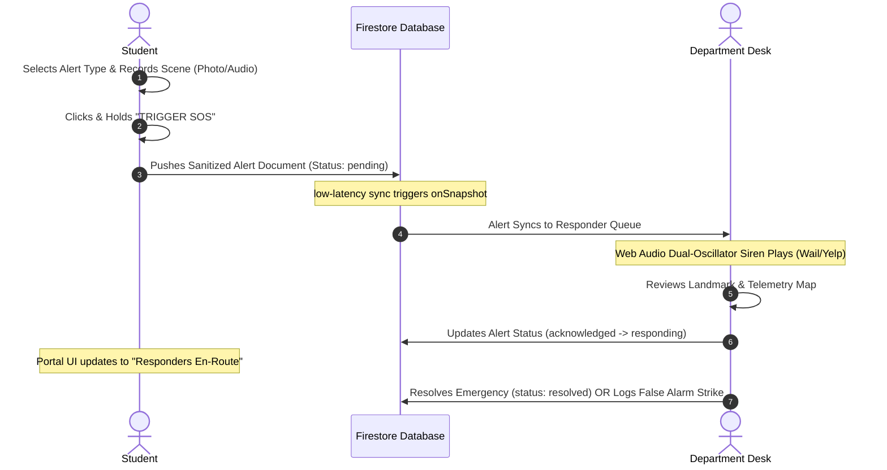

# FULALERT: Emergency Response & Crisis Management System
### Software Design, Architecture, and Operational Documentation
*Tailored for Federal University Lokoja (FUL)*

---

## Table of Contents
1. [Introduction](#1-introduction)
   - [Background of the Topic](#background-of-the-topic)
   - [Problem Statement](#problem-statement)
   - [Aim and Objective](#aim-and-objective)
2. [Method and Methodology](#2-method-and-methodology)
   - [Method: Frontend Activation & Triggers](#method-frontend-activation--triggers)
   - [Methodology: Step-by-Step System Execution](#methodology-step-by-step-system-execution)
3. [Interface Explanation](#3-interface-explanation)
   - [Landing Portal](#landing-portal)
   - [Student Safety Dashboard](#student-safety-dashboard)
   - [Unified Officer Login Page](#unified-officer-login-page)
   - [Admin/Dispatcher Dashboard Console](#admindispatcher-dashboard-console)
4. [Conclusion: Significance to Federal University Lokoja (FUL)](#4-conclusion-significance-to-federal-university-lokoja-ful)
5. [References](#5-references)

---

## 1. Introduction

### Background of the Topic
In the contemporary landscape of higher education management, the security of students, faculty, and physical infrastructure has emerged as a paramount institutional priority. Tertiary institutions represent dense micro-communities containing residential areas (hostels), laboratory complexes, lecture theaters, administrative offices, and social hubs. This density, combined with the diverse nature of campus life, exposes universities to a wide range of emergency scenarios, including:
- Acute medical crises (e.g., asthmatic attacks, sickle cell crises, cardiovascular incidents).
- Security threats (e.g., intrusions, physical assaults, theft, gang activities, cultism).
- Fire outbreaks (e.g., electrical faults in student hostels, chemical spills in laboratories).
- Social and administrative issues (e.g., gender-based violence, academic intimidation, and student welfare crises).

Traditionally, emergency notifications on university campuses relied on loud, non-specific sirens, word-of-mouth reports, or localized security guard rooms. These methods have significant limitations. With the rise of smart device technologies, high-speed mobile networks, and real-time cloud computing, there is an opportunity to digitize campus safety. 

**FULALERT** is a real-time, cloud-synchronized emergency dispatch and safety management web application. By leveraging modern web browsers, it runs on standard smartphones without requiring complex app-store installations. The system utilizes:
- The **W3C Geolocation API** to capture exact coordinate telemetry.
- The **Web Audio API** to synthesize alarms and process voice notes.
- **Firebase Firestore**'s document synchronization to bypass composite query limitations and deliver sub-second data transmission.
- **Vercel** serverless environments to maintain continuous availability.

### Problem Statement
Federal University Lokoja (FUL) is a fast-growing institution in Kogi State, Nigeria, operating across two main campuses: the Adankolo Campus and the Felele Campus. This split-campus structure introduces several operational challenges for safety dispatch:

1. **Geographical Separation**: The physical distance between the campuses slows down centralized communication. A crisis at the Felele campus may not be immediately noticed or coordinate-mapped by dispatchers at Adankolo.
2. **Lack of Location Telemetry**: When an emergency occurs—especially at night or in remote parts of the campus—students struggle to explain their exact coordinates. This leads to rescue delays as responders search for the scene.
3. **No Direct Channels for Sensitive Issues**: Incidents involving harassment or gender-based violence (GBV) often go unreported because students are hesitant to discuss them at open, public security posts.
4. **Delayed Responder Notifications**: Traditional desktop alerts can go unnoticed. Without an automated, audible alarm synced directly to incoming incidents, emergency logs can remain unread.
5. **False Alarm Vulnerability**: Anonymity in reporting allows users to trigger false alarms without accountability, wasting limited university security and medical resources.

### Aim and Objective
The primary aim of **FULALERT** is to design, implement, and deploy a secure, real-time emergency dispatch and safety management web application tailored to the split-campus structure of Federal University Lokoja.

**Objectives:**
- **Create a Mobile-Responsive Student Portal**: Develop an intuitive interface that allows students to trigger an SOS alert in under three seconds. This portal must support media attachments (voice memos, photo uploads) to provide immediate context from the scene.
- **Establish a Unified Officer Login Gateway**: Implement a secure gateway for authorized responders, featuring department selection and master authorization keys to prevent unauthorized access.
- **Deploy Specialized Dispatch Dashboards**: Build custom dashboard interfaces for **Security**, **Health Centre**, **Fire Safety**, **DSA Welfare**, and **Central Command** to route alerts directly to the correct responder units.
- **Develop a Web Audio Siren Synthesizer**: Create an automated yelping siren that plays on the dispatcher's dashboard when pending incidents are detected.
- **Incorporate a Student Strike and Penalty Tracking System**: Implement a three-strike visual disciplinary registry for false alarms to deter system misuse.

---

## 2. Method and Methodology

### Method: Frontend Activation & Triggers
The frontend of FULALERT is built using React, CSS variables, and Lucide Icons. It communicates with the database and triggers local system features via the following mechanisms:

```
[Student Portal UI] ---> (SOS Trigger Event) ---> [Geolocation API] ---> [Web Audio API / Camera]
                                                                                |
                                                                                v
[Firestore Database] <-- (Push Sanitized Document) <-----------------[Base64 Media Encoder]
```

#### 1. Geolocation Capture and Landmark Translation
When a student triggers the SOS button, the browser calls the HTML5 Geolocation API:
```javascript
navigator.geolocation.getCurrentPosition(successCallback, errorCallback, {
  enableHighAccuracy: true,
  timeout: 5000,
  maximumAge: 0
});
```
This returns the student's exact latitude and longitude. The app then calculates the distance to pre-mapped landmarks on the FUL campuses using the Euclidean distance formula:
$$d = \sqrt{(x_2 - x_1)^2 + (y_2 - y_1)^2}$$
The closest landmark (e.g., SUG Secretariat, Hostel Block A, Adankolo Gate) is assigned to the alert document. This ensures that dispatchers receive both raw GPS coordinates and a clear, readable landmark description.

#### 2. Base64 Media Serialization
To attach audio recordings or camera photos without the overhead of heavy file-upload libraries, FULALERT serializes binary media files into Base64 strings.
- **Audio Capture**: The app uses the browser's `MediaRecorder` API to capture microphone input, converts it to an array buffer, and encodes it to a Base64 data URI (e.g., `data:audio/ogg;base64,...`).
- **Photo Capture**: Images captured by the device's camera are drawn onto an HTML5 canvas element and converted to a compressed JPEG data URI (e.g., `data:image/jpeg;base64,...`).
These lightweight strings are embedded directly into the Firestore alert document, keeping the upload atomic and reducing database write delays.

#### 3. Real-time Firestore Listeners
To avoid high polling overhead, the dispatcher dashboards use Firestore's native WebSockets listener `onSnapshot`. The app sets up a real-time subscription to the `alerts` collection:
```javascript
const q = query(collection(db, 'alerts'));
const unsubscribe = onSnapshot(q, (snapshot) => {
  const alertsList = [];
  snapshot.forEach(doc => alertsList.push({ id: doc.id, ...doc.data() }));
  // Local sorting to bypass missing composite index limitations
  alertsList.sort((a, b) => new Date(b.timestamp) - new Date(a.timestamp));
  updateLocalState(alertsList);
});
```

#### 4. Web Audio Siren Synthesizer
To comply with browser security policies that block automated audio playback, the dashboard initializes a shared `AudioContext` on the dispatcher's first interaction with the page. When a new alert is received:
- Two web oscillators are created: a **Sawtooth Wave** (representing security) and a **Square Wave** (providing the detuned chorus effect).
- A low-frequency oscillator (LFO) sweep modulates the frequency of the oscillators between **600Hz and 1200Hz** at a rate of **5Hz** to create a yelping vehicle siren effect.
- The sound plays automatically only when there are active, pending alerts matching the dispatcher's department.

---

### Methodology: Step-by-Step System Execution

The diagram below details the chronological steps of an emergency lifecycle:



#### Step 1: Student Account Authentication
The student registers or logs in via Firebase Auth on their mobile device. The app caches the student's profile (name, matriculation number, phone number, blood type, and emergency contacts) in local storage for quick access.

#### Step 2: Emergency Configuration
The student opens the app and selects an emergency category: **Security**, **Medical**, **Fire**, or **DSA Welfare**. They can add an optional description, record a short voice note, or take a photo of the scene.

#### Step 3: SOS Activation
The student presses and holds the central "TRIGGER SOS" button for a three-second countdown. This countdown prevents accidental activations. Once completed, the app captures their GPS coordinates, maps them to the nearest FUL landmark, and packages this data with their profile information.

#### Step 4: Database Transmission
The app sanitizes the data payload to remove any `undefined` fields and writes the document to the Firestore `/alerts` collection with a status of `'pending'`.

#### Step 5: Real-time Dispatch Sync
The Firestore subscription fires on the dispatcher dashboards. If the alert's category matches the dispatcher's desk (e.g., `medical` alerts route to the Health Centre), the incident is added to their queue.

#### Step 6: Siren Activation & Dispatch
The dashboard's web audio synthesizer plays the emergency siren to alert the dispatcher. The dispatcher views the incident coordinates on the campus map and clicks **ACK** (Acknowledge) or **DISPATCH**. This updates the alert status in Firestore to `'responding'`.

#### Step 7: Real-time Student Feedback
The status change syncs back to the student's device. Their screen updates to show that responders are en-route, displaying the name of the assigned responding unit.

#### Step 8: Resolution & Review
Once responders resolve the emergency on-site, the dispatcher enters resolution notes and clicks **RESOLVE** to close the case. If the alert was a prank, the dispatcher clicks **FALSE ALARM**, which logs a strike against the student's matriculation record in the database.

---

## 3. Interface Explanation

### Landing Portal
The entry point of the application is a dark, responsive landing page designed for quick routing:
- **Student Emergency Access**: A large red portal button directing students to sign in and request help.
- **Officer Secure Login**: A secure entrance for official university responders to access the dispatcher desks.

### Student Safety Dashboard
The Student Safety Portal is designed for quick, one-handed operation on mobile devices during stressful situations:
- **Category Grid**: Large, color-coded buttons that allow the student to select the type of emergency:
  - 🔴 **Security** (Red)
  - 🟢 **Medical** (Green)
  - 🟠 **Fire Safety** (Orange)
  - 🟣 **DSA Welfare** (Purple)
- **Central SOS Button**: A prominent, pulsing red button that triggers when held, showing a circular visual countdown to prevent accidental activation.
- **Active SOS Overlay**: When active, it displays a ticking timer, the name of the assigned responder unit, and status badges (e.g. "Awaiting Dispatch", "Responders En-Route").
- **Media Attachment Badges**: Standard file upload prompts are replaced with interactive badges that preview photo uploads and allow on-the-spot voice note playback.

### Unified Officer Login Page
This single, unified authentication gate manages access for all departments:
- **Department Selector Dropdown**: Officers select their department (Security, Medical, Fire, DSA, or Central Command) from a dropdown list. The page's theme, icon badges, and placeholder credentials adapt automatically to the selection.
- **Credentials Validation**: Validates the Badge ID format (e.g., `SEC-101`) and checks the passcode. 
- **Department Master Key Authorization**: Officers can register new accounts securely by providing their official name, a secure university email address, and their department's master key.
- **Session Security**: Active logins are cached in the browser's `sessionStorage` instead of `localStorage`. This allows responders to refresh the page without losing their login, but automatically logs them out when they close the browser tab to protect sensitive data.

### Admin/Dispatcher Dashboard Console
The Responder Dashboard serves as the central command hub for dispatchers:
- **Active Incident Queue (Sidebar)**: A chronological, color-coded list of incoming emergencies. It features bulk cleanup actions, including **🧹 Clear Resolved** (to remove resolved cases) and **🗑️ Delete All** (to clear all alerts).
- **Interactive SVG Campus Map**: A vector map of the Federal University Lokoja campus. It plots real-time incident pins, showing a dotted dispatch route from the department's base station to the student's location.
- **Incident Detail Panel**: Displays the student's profile details, emergency contact information, and coordinates. It also provides links to open Google Maps navigation directly to the student's location.
- **Stealth Audio Sniffer Widget**: Plays audio clips uploaded from the incident scene, complete with transcripts.
- **Broadcast Control Tab**: A form that allows dispatchers to broadcast safety advisories and warnings (Information, Warning, or Critical Danger) to all students' portals.
- **Hotspots Analytics Tab**: A canvas-based heatmap that plots historical coordinate data to show safety trends and high-density incident locations on campus.
- **Misuse & Strike Registry**: A disciplinary interface showing a list of registered students. It features a three-strike visual tracking system for false alarms and a **🗑️ Delete User** button to manage accounts.

---

## 4. Conclusion: Significance to Federal University Lokoja (FUL)

The implementation of FULALERT has significant benefits for safety and operations at Federal University Lokoja:

1. **Bridges Campus Dispersal Gaps**: FUL's split campus structure (Adankolo and Felele) makes physical communication difficult. FULALERT solves this by routing requests to the appropriate local responders instantly, regardless of physical campus boundaries.
2. **Protects Student Welfare**: The **DSA Welfare Desk** provides a private, secure channel for students to report harassment or gender-based violence (GBV) confidentially, bypassing public security desks.
3. **Improves Medical Triage**: Connecting students directly to the **University Health Centre** enables doctors and ambulance drivers to receive patient location maps and view critical medical histories (blood type, allergies) before arriving at the scene.
4. **Protects Campus Infrastructure**: The **Fire Safety & Warden Desk** allows students in hostels to report electrical faults or fires immediately, reducing response times and protecting university property.
5. **Deters System Abuse**: The false alarm tracking system deters students from reporting fake emergencies, keeping response teams free for real crises.

---

## 5. References
1. **Google Firebase Documentation**: *Cloud Firestore Queries, Security Rules, and Authentication Handlers.* [https://firebase.google.com/docs](https://firebase.google.com/docs)
2. **W3C Geolocation API Specification**: *Position Telemetry and High-Accuracy Tracking on Smart Devices.* [https://www.w3.org/TR/geolocation/](https://www.w3.org/TR/geolocation/)
3. **Mozilla Web Audio API Reference**: *Synthesizing Sawtooth & Square Waves with LFO Frequency Modulation.* [https://developer.mozilla.org/en-US/docs/Web/API/Web_Audio_API](https://developer.mozilla.org/en-US/docs/Web/API/Web_Audio_API)
4. **Federal University Lokoja General Regulations**: *Student Safety Handbook, Hostel Security Guidelines, and Disciplinary Protocols.*
