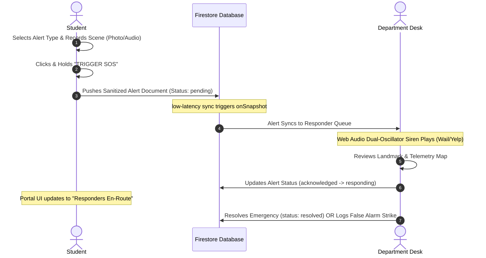

# FULALERT: Emergency Response & Crisis Management System
### Software Design, Architecture, and Operational Documentation
*Tailored for Federal University Lokoja (FUL)*

---

## Table of Contents
1. [Introduction](#1-introduction)
   - [Background of the Topic](#background-of-the-topic)
   - [Problem Statement](#problem-statement)
   - [Aim and Objective](#aim-and-objective)
2. [Method and Methodology](#2-method-and-methodology)
   - [Method: Frontend Activation & Triggers](#method-frontend-activation--triggers)
   - [Methodology: Step-by-Step System Execution](#methodology-step-by-step-system-execution)
3. [Interface Explanation](#3-interface-explanation)
   - [Landing Portal](#landing-portal)
   - [Student Safety Dashboard](#student-safety-dashboard)
   - [Unified Officer Login Page](#unified-officer-login-page)
   - [Admin/Dispatcher Dashboard Console](#admindispatcher-dashboard-console)
4. [Conclusion: Significance to Federal University Lokoja (FUL)](#4-conclusion-significance-to-federal-university-lokoja-ful)
5. [References](#5-references)

---

## 1. Introduction

### Background of the Topic
In modern tertiary institutions, campus safety and emergency response times are critical factors influencing student well-being and academic focus. Historically, emergency notifications on university campuses relied on physical alarms, word-of-mouth reports, or localized security booths. However, with the widespread availability of web technologies, smart devices, and real-time cloud computing, universities are moving towards integrated, digital campus safety platforms. 

**FULALERT** is a real-time web-based crisis response system designed to digitize safety dispatch workflows. By utilizing modern web features—such as Geolocation APIs, Web Audio synthesizers, and real-time cloud-synchronized document stores—it bridges the critical time gap between incident occurrence and responder arrival.

### Problem Statement
Federal University Lokoja (FUL) operates across multiple campus locations (including the Adankolo and Felele campuses). Currently, students facing emergencies—such as health issues in hostels, fire outbreaks, physical threats, or academic harassment—have no centralized, low-latency method to contact responder units. Relying on phone numbers or physical security desks causes several issues:
1. **Lack of Telemetry**: Dispatchers do not receive coordinates or locations, leading to delayed rescues.
2. **Lack of Evidence**: Responders cannot preview the scene via incident photos or silent audio recordings.
3. **Delayed Alerting**: No automated siren or audible dispatcher notifications exist, meaning emergencies can sit unread on desk logs.
4. **False Alarm Vulnerability**: Anonymity in reporting allows users to report false alarms without disciplinary tracking.

### Aim and Objective
The aim of the **FULALERT** project is to design, implement, and deploy a secure, real-time emergency dispatch and safety management system for Federal University Lokoja.

**Objectives:**
- Create a mobile-responsive Student Portal allowing immediate SOS triggers with media attachments (voice memos, photo uploads).
- Implement a Unified Officer Login Portal requiring official credentials and department master keys to prevent unauthorized dashboard access.
- Deploy specialized dispatch dashboards for **Security**, **Health Centre**, **Fire Safety**, **DSA Welfare**, and **Central Command**.
- Develop a dual-oscillator synthesizer wailing siren that plays automatically on the dashboard when pending emergencies are detected.
- Incorporate a student strike/penalty tracking registry to deter false alarms in compliance with university discipline policies.

---

## 2. Method and Methodology

### Method: Frontend Activation & Triggers
The frontend of FULALERT is built using React, CSS variables, and Lucide Icons. It communicates with the database and triggers local system features via the following mechanisms:

```
[Student Portal UI] ---> (SOS Trigger Event) ---> [Geolocation API] ---> [Web Audio API / Camera]
                                                                                |
                                                                                v
[Firestore Database] <-- (Push Sanitized Document) <-----------------[Base64 Media Encoder]
```

1. **SOS Dispatch Trigger**: A high-priority event is dispatched when a student clicks or holds the central SOS button. This captures:
   - **Position Telemetry**: Obtained via the HTML5 `navigator.geolocation` API, mapping the student's exact coordinates.
   - **Landmark Mapping**: Translates raw coordinates to closest pre-mapped university landmarks (e.g. SUG Secretariat, Male Hostel Block A, Academic Complex) using Euclidean distance algorithms.
2. **Base64 Media Encoder**: Audio clips recorded via the student’s microphone (`MediaRecorder` API) or pictures taken with their camera are read as arrays and encoded into compact Base64 strings. These are appended directly into the incident document payload to bypass storage buckets and keep writes atomic.
3. **Real-time Firestore Listeners**: Admin dashboards subscribe to the database using Firestore's `onSnapshot` listener. Any document added to the `/alerts` collection instantly updates the React state of the active officer's desk.
4. **Dual-Oscillator Synthesizer (Siren)**: The dashboard utilizes the Web Audio API to bypass browser autoplay blocks. Upon user interaction, it instantiates an `AudioContext` which synthesizes a detuned yelping siren using two oscillators (Sawtooth and Square waves sweep-modulated at 5Hz) when pending alerts are present.

### Methodology: Step-by-Step System Execution

The diagram below details the chronological steps of an emergency lifecycle:



#### Step 1: Student Incident Configuration
The student opens the app on a mobile device and selects an emergency category: **Security**, **Medical**, **Fire**, or **DSA Welfare**. They can add an explanation or attach photos/voice recordings.

#### Step 2: SOS Transmission
When the student holds the SOS button, the browser requests coordinates and constructs a payload, setting the status to `'pending'` and recording time strings. It then pushes the payload to the Firestore cloud database.

#### Step 3: Cloud Synchronization
Firestore receives the payload and runs database security rules, synchronizing the document.

#### Step 4: Dispatcher Alert & Audio Hook
The desk dashboard listening to Firestore receives the new alert. If it matches the department's category (e.g. a `medical` alert at the Health Centre desk), the screen flashes red and the Web Audio synthesizer begins playing the emergency siren.

#### Step 5: Acknowledgment & Routing
The dispatcher clicks **ACK** (Acknowledge) or **DISPATCH**. This writes a status update to the cloud, changing `'pending'` to `'responding'`. The student portal updates in real-time, showing that help is en-route. The dispatcher can also click a Google Maps link to open turn-by-turn driving directions to the student's exact coordinates.

#### Step 6: Field Action & Resolution
Responders arrive at the scene. The dispatcher logs notes and clicks **RESOLVE** to close the case. If the incident was a prank, they click **FALSE ALARM**, which logs a strike on the student's registry account.

---

## 3. Interface Explanation

### Landing Portal
Upon loading the application, users are presented with a premium, clean landing gateway:
- **Student Emergency Access**: A large red portal button directing students to sign in and request help.
- **Officer Secure Login**: A secure entrance for official university responders to access the dispatcher desks.

### Student Safety Dashboard
The Student Safety Portal is designed for quick, one-handed operation on mobile devices during stressful situations:
- **Central SOS Button**: A prominent, pulsing red button that triggers when held, showing a circular visual countdown to prevent accidental activation.
- **Incident Categorizer**: Quick toggle icons for reporting Security Threats, Medical Emergencies, Fire Hazards, or Harassment.
- **Active SOS Overlay**: When active, it displays a ticking timer, the name of the assigned responder unit, and status badges (e.g. "Awaiting Dispatch", "Responders En-Route").
- **Media Attachment Badges**: Standard file upload prompts are replaced with interactive badges that preview photo uploads and allow on-the-spot voice note playback.

### Unified Officer Login Page
This single, unified authentication gate manages access for all departments:
- **Department Selector Dropdown**: Officers select their department (Security, Medical, Fire, DSA, or Central Command) from a dropdown list. The page's theme, icon badges, and placeholder credentials adapt automatically to the selection.
- **Official Credentials Check**: Validates the Badge ID format (e.g., `SEC-101`) and checks the passcode. 
- **Department Master Key Authorization**: Officers can register new accounts securely by providing their official name, a secure university email address, and their department's master key.
- **Session Security**: Active logins are cached in the browser's `sessionStorage` instead of `localStorage`. This allows responders to refresh the page without losing their login, but automatically logs them out when they close the browser tab to protect sensitive data.

### Admin/Dispatcher Dashboard Console
The Responder Dashboard serves as the central command hub for dispatchers:
- **Active Incident Queue (Sidebar)**: A chronological, color-coded list of incoming emergencies. It features bulk cleanup actions, including **🧹 Clear Resolved** (to remove resolved cases) and **🗑️ Delete All** (to clear all alerts).
- **Interactive SVG Campus Map**: A vector map of the Federal University Lokoja campus. It plots real-time incident pins, showing a dotted dispatch route from the department's base station to the student's location.
- **Turn-by-Turn Routing**: A link that opens Google Maps navigation directly to the student's coordinate location.
- **Stealth Audio Sniffer Widget**: Plays audio clips uploaded from the incident scene, complete with transcripts.
- **Broadcast Control Tab**: A form that allows dispatchers to broadcast safety advisories and warnings (Information, Warning, or Critical Danger) to all students' portals.
- **Hotspots Analytics Tab**: A canvas-based heatmap that plots historical coordinate data to show safety trends and high-density incident locations on campus.
- **Misuse & Strike Registry**: A disciplinary interface showing a list of registered students. It features a three-strike visual tracking system for false alarms and a **🗑️ Delete User** button to manage accounts.

---

## 4. Conclusion: Significance to Federal University Lokoja (FUL)

The implementation of FULALERT has significant benefits for safety and operations at Federal University Lokoja:

1. **Bridges Campus Dispersal Gaps**: FUL's split campus structure (Adankolo and Felele) makes physical communication difficult. FULALERT solves this by routing requests to the appropriate local responders instantly, regardless of physical campus boundaries.
2. **Protects Student Welfare**: The **DSA Welfare Desk** provides a private, secure channel for students to report harassment or gender-based violence (GBV) confidentially, bypassing public security desks.
3. **Improves Medical Triage**: Connecting students directly to the **University Health Centre** enables doctors and ambulance drivers to receive patient location maps and view critical medical histories (blood type, allergies) before arriving at the scene.
4. **Protects Campus Infrastructure**: The **Fire Safety & Warden Desk** allows students in hostels to report electrical faults or fires immediately, reducing response times and protecting university property.
5. **Deters System Abuse**: The false alarm tracking system deters students from reporting fake emergencies, keeping response teams free for real crises.

---

## 5. References
1. **Google Firebase Documentation**: *Cloud Firestore Queries, Security Rules, and Authentication Handlers.* [https://firebase.google.com/docs](https://firebase.google.com/docs)
2. **W3C Geolocation API Specification**: *Position Telemetry and High-Accuracy Tracking on Smart Devices.* [https://www.w3.org/TR/geolocation/](https://www.w3.org/TR/geolocation/)
3. **Mozilla Web Audio API Reference**: *Synthesizing Sawtooth & Square Waves with LFO Frequency Modulation.* [https://developer.mozilla.org/en-US/docs/Web/API/Web_Audio_API](https://developer.mozilla.org/en-US/docs/Web/API/Web_Audio_API)
4. **Federal University Lokoja General Regulations**: *Student Safety Handbook, Hostel Security Guidelines, and Disciplinary Protocols.*
